<!--
  GitHub profile README for github.com/sumankrsh
  Graphics live in assets/dark and assets/light (desktop) and assets/compact (phones and
  narrow windows, below 1100px), all generated by scripts/build_assets.py.
  The "Latest writing" list is refreshed daily by .github/workflows/blog-posts.yml.
-->

<a href="https://www.mukherjeesuman.com">
  <picture>
    <source media="(max-width: 1099px)" srcset="assets/compact/hero.svg">
    <source media="(prefers-color-scheme: dark)" srcset="assets/dark/hero.svg">
    
  </picture>
</a>

  <a href="https://www.mukherjeesuman.com"><picture><source media="(prefers-color-scheme: dark)" srcset="assets/dark/btn-site.svg"></picture></a>&nbsp;
  <a href="https://www.linkedin.com/in/sumanmukherjee91k/"><picture><source media="(prefers-color-scheme: dark)" srcset="assets/dark/btn-linkedin.svg"></picture></a>&nbsp;
  <a href="mailto:contactme@mukherjeesuman.com"><picture><source media="(prefers-color-scheme: dark)" srcset="assets/dark/btn-email.svg"></picture></a>&nbsp;
  <a href="https://www.mukherjeesuman.com/blog"><picture><source media="(prefers-color-scheme: dark)" srcset="assets/dark/btn-blog.svg"></picture></a>

<picture>
  <source media="(max-width: 1099px)" srcset="assets/compact/metrics.svg">
    <source media="(prefers-color-scheme: dark)" srcset="assets/dark/metrics.svg">
  
</picture>

 

<h3 align="center">I run Data & AI portfolios in insurance. The part I care about most is what happens <i>after</i> the pilot.</h3>

  Getting GenAI and agentic AI into production with the controls a regulator would expect: 
  clear ownership, audit-ready documentation, a human in the loop, and outcomes measured in conversion, retention and run-cost.

<i>“I don't do demos. I ship outcomes, with governance that holds up in the audit room.”</i>

 

## ✦ How I take AI from POC to P&L

<picture>
  <source media="(max-width: 1099px)" srcset="assets/compact/pipeline.svg">
    <source media="(prefers-color-scheme: dark)" srcset="assets/dark/pipeline.svg">
  
</picture>

## ✦ Selected programmes

<picture>
  <source media="(max-width: 1099px)" srcset="assets/compact/programmes.svg">
    <source media="(prefers-color-scheme: dark)" srcset="assets/dark/programmes.svg">
  
</picture>

Client and employer names are left out on purpose. Want the detail behind any of these? <a href="https://www.mukherjeesuman.com">Ask my site</a>: it answers from my real work.

## ✦ Built in the open

  <a href="https://www.mukherjeesuman.com"><picture><source media="(max-width: 1099px)" srcset="assets/compact/project-portfolio.svg"><source media="(prefers-color-scheme: dark)" srcset="assets/dark/project-portfolio.svg"></picture></a>
  <a href="https://github.com/sumankrsh/medicine-drug-advisor"><picture><source media="(max-width: 1099px)" srcset="assets/compact/project-medicine.svg"><source media="(prefers-color-scheme: dark)" srcset="assets/dark/project-medicine.svg"></picture></a>

  <a href="https://github.com/sumankrsh/ai-accelerator-toolkit"><picture><source media="(max-width: 1099px)" srcset="assets/compact/project-accelerator.svg"><source media="(prefers-color-scheme: dark)" srcset="assets/dark/project-accelerator.svg"></picture></a>
  <a href="https://github.com/sumankrsh/Sentiment-Analysis.ipynb"><picture><source media="(max-width: 1099px)" srcset="assets/compact/project-sentiment.svg"><source media="(prefers-color-scheme: dark)" srcset="assets/dark/project-sentiment.svg"></picture></a>

  More: <a href="https://github.com/sumankrsh/movie-recommendation-system">Recommendation system</a> ·
  <a href="https://github.com/sumankrsh/Anomaly-Detection-Model-">Anomaly detection</a> ·
  <a href="https://github.com/sumankrsh/Breast-Cancer-Detection-Model">Tabular deep learning</a>

### ✦ Fresh builds

<!-- FRESH-BUILDS:START -->
- [**Local Redact**](https://github.com/sumankrsh/local-redact) · Redact sensitive data before you paste it into an LLM. Runs in your browser ([live demo](https://sumankrsh.github.io/local-redact/)).
- [**Agentic Claims Triage**](https://github.com/sumankrsh/agentic-claims-triage) · A LangGraph claims-triage agent with PII redaction, coverage checks, human review and an audit log. Synthetic data.
- [**Insurance Policy Copilot**](https://github.com/sumankrsh/insurance-policy-copilot) · Policy Q&A with cited answers and surrender-risk scoring, with human review and an audit log. Synthetic data.
<!-- FRESH-BUILDS:END -->

## ✦ Toolbox

  

<picture>
  <source media="(max-width: 1099px)" srcset="assets/compact/toolbox.svg">
    <source media="(prefers-color-scheme: dark)" srcset="assets/dark/toolbox.svg">
  
</picture>

## ✦ Credentials

<picture>
  <source media="(max-width: 1099px)" srcset="assets/compact/credentials.svg">
    <source media="(prefers-color-scheme: dark)" srcset="assets/dark/credentials.svg">
  
</picture>

## ✦ Latest writing

<!-- BLOG-POST-LIST:START -->
- [**Building a GCC That Leads, Not Just Delivers: A Data &amp; AI Playbook**](https://www.mukherjeesuman.com/blog/building-gcc-that-leads-data-ai-playbook) A first-person playbook for moving a GCC in India from delivery hub to data and AI capability centre: outcomes, product teams, governance and leadership.
- [**From AI Pilot to Production in Insurance: A Leader&#39;s Checklist**](https://www.mukherjeesuman.com/blog/ai-pilot-to-production-insurance-checklist) Eight questions I use to decide whether an AI or GenAI initiative in insurance and BFSI is ready for governed production, from value to adoption.

<!-- BLOG-POST-LIST:END -->

<a href="https://www.mukherjeesuman.com/blog">All posts →</a>

## ✦ Off the clock

🎸 Guitar after hours &nbsp;·&nbsp; 🤘 Dream Theater, always &nbsp;·&nbsp; 🐾 Proud cat dad to Golu

 

<a href="https://www.mukherjeesuman.com">
  <picture>
    <source media="(max-width: 1099px)" srcset="assets/compact/cta.svg">
    <source media="(prefers-color-scheme: dark)" srcset="assets/dark/cta.svg">
    
  </picture>
</a>

  <a href="mailto:contactme@mukherjeesuman.com">contactme@mukherjeesuman.com</a> &nbsp;·&nbsp;
  <a href="https://www.linkedin.com/in/sumanmukherjee91k/">LinkedIn</a> &nbsp;·&nbsp;
  <a href="https://www.mukherjeesuman.com">mukherjeesuman.com</a>

<picture>
  <source media="(prefers-color-scheme: dark)" srcset="assets/dark/footer.svg">
  
</picture>

   
  <i>Views are my own and do not represent any employer.</i>

